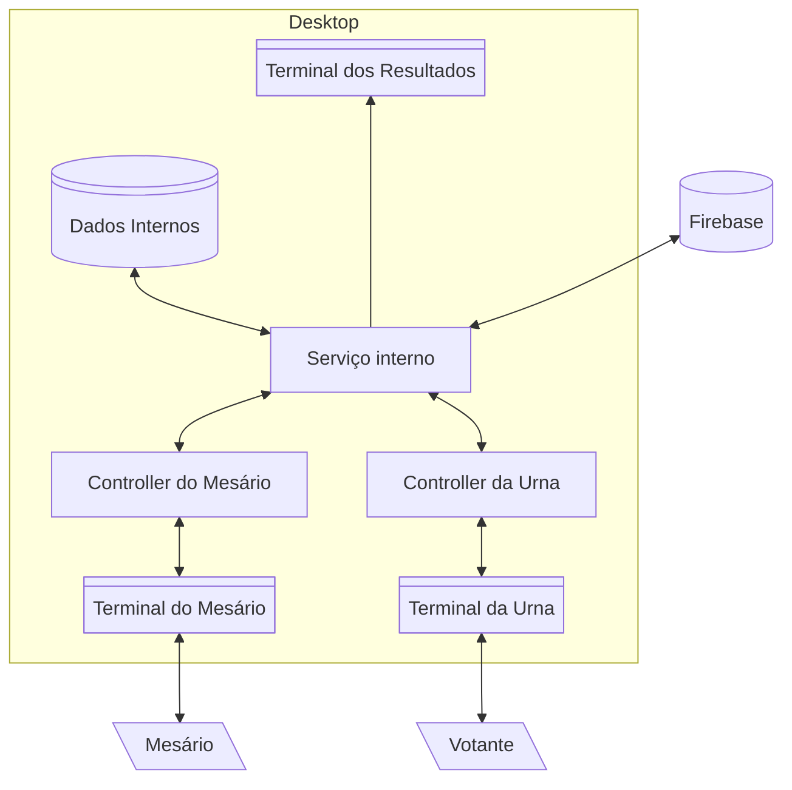
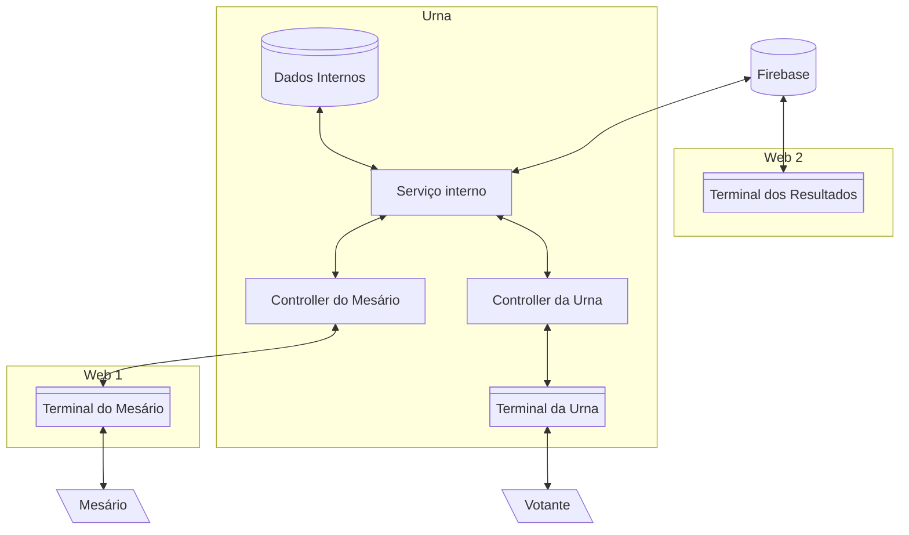
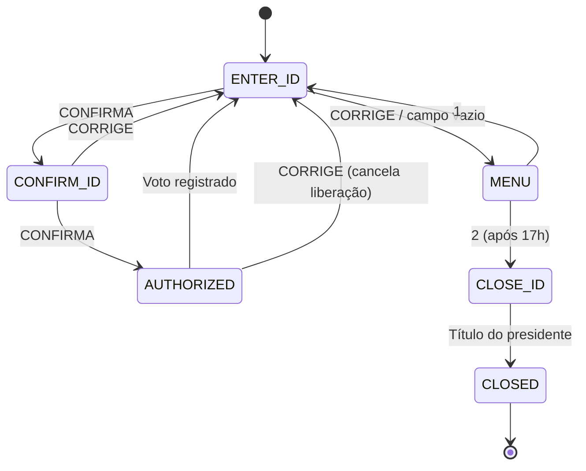
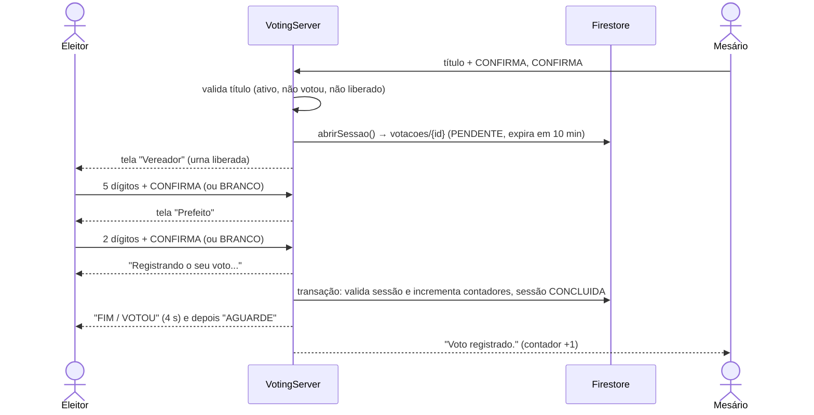

# Urna Eletrônica

Urna eletrônica de votação municipal (vereador e prefeito)
Projeto escrito em Java 21, com interface em Swing. Usa firebase para obter dados de candidatos e eleitores, assim como armazenar os dados da votação.

Chame o programa com a variável `--embedded` (ou `-e`) para executar o programa no modo embarcado (destinado e testado no raspberry pi +3 B).

O sistema tem três atores:

- O **eleitor** (vota);
- O **mesário** (libera a urna e encerra a votação);
- O **Firebase** (guarda sessões, contadores e cadastros).

---

## 1. Arquitetura

Em ambos os modos existe um núcleo lógico único, núcleo esse que concentra toda a regra de negócio e o estado.
As views e os controllers só traduzem entrada do usuário em chamadas ao serviço e renderizam o estado que o serviço publica.

### 1.1 Modo Desktop

Tudo roda no mesmo processo.
O terminal do mesário e o terminal da urna são duas janelas Swing.
Ao encerrar a votação, o terminal de resultados (o boletim de urna) abre no mesmo computador.



### 1.2 Modo Embarcado

A urna (em um Raspberry Pi) roda o serviço, o controller da urna e a tela cheia do eleitor.
O terminal do mesário é uma página web servida pela própria urna, aberta no celular ou no PC do mesário na mesma rede.
O terminal dos resultados é um cliente web separado que lê os resultados direto do Firebase, sem passar pela urna.



### 1.3 Onde cada caixa dos diagramas está no código

| Caixa do diagrama                       | Classe(s)                                                                           | Observações                                                                                                                 |
| --------------------------------------- | ----------------------------------------------------------------------------------- | --------------------------------------------------------------------------------------------------------------------------- |
| **Serviço interno**                     | `application/VotingServer`                                                          | Máquina de estados do mesário, sessões de voto, contadores. Único dono do estado.                                           |
| **Dados internos**                      | `domain/*` e `application/UrnaRepositories`                                         | Snapshot de candidatos, partidos e eleitores carregado do Firebase na inicialização e mantido em memória.                   |
| **Firebase**                            | `infra/firebase/*` atrás da porta `application/VotingGateway`                       | `RegistroVotacaoService` (sessões e votos), `FirestoreUrnaSnapshotService` (carga inicial), `ApuracaoService` (resultados). |
| **Controller do Mesário**               | `controller/poolWorker/DesktopPoolWorkerController`, `EmbeddedPoolWorkerController` | Repassa teclas ao serviço e entrega o estado do visor à tela.                                                               |
| **Terminal do Mesário** (desktop)       | `view/PoolWorkerView`                                                               | Janela com visor LCD, LEDs e teclado.                                                                                       |
| **Terminal do Mesário** (embarcado)     | `controller/poolWorker/MesarioWebServer` + `resources/web/mesario.html`             | Servidor Javalin com a mesma interface em HTML.                                                                             |
| **Controller da Urna**                  | `controller/VoterController`                                                        | Digitação do eleitor: vereador, depois prefeito.                                                                            |
| **Terminal da Urna** (desktop)          | `view/VoterView`                                                                    | Janela com a tela e botões.                                                                                                 |
| **Terminal da Urna** (embarcado)        | `view/VotingScreenEmbeddedContainer`                                                | Tela cheia, sem cursor, teclado matricial.                                                                                  |
| **Terminal dos Resultados** (desktop)   | `view/BulletinView`, gerado por `application/BallotBox`                             | Também grava `boletim-<eleicao>.txt`.                                                                                       |
| **Terminal dos Resultados** (embarcado) | _fora deste repositório_                                                            | Cliente web. A urna só imprime o boletim no console e salva o arquivo.                                                      |

### 1.4 Estrutura de pacotes

```
com.lumi2021.urna
    ├── Program.java               Ponto de entrada: só escolhe o modo e liga as peças
    ├── application/               Regras de negócio
    │   ├── VotingServer               Core: estados do mesário, sessão do eleitor, contadores, callbacks
    │   ├── UrnaContext                Monta o que é comum aos dois modos (Firebase, dados, servidor, boletins)
    │   ├── VotingGateway              Porta para o backend (abrir eleição, abrir sessão, registrar voto)
    │   ├── VotingService              Adapter entre o gateway e o Firestore
    │   ├── UrnaRepositories           Carrega o snapshot inicial durante o boot e fornece os dados
    │   ├── BallotBox                  Monta o documento do boletim de urna com a apuração real
    │   └── BulletinService            Emite o boletim
    ├── domain/                    Entidades e repositórios em memória (candidato, partido, eleitor, boletim)
    ├── infra/firebase/            Tudo que fala com o Firestore (conexão, transações, validação, apuração)
    ├── controller/                VoterController e os controllers do mesário (+ MesarioWebServer)
    ├── platform/                  Entrada: InputService (Desktop = teclado Swing, Embedded = teclado matricial + Pi4J)
    │   ├── boot/                      Modos de inicialização
    │   │   ├── UrnaMode                   Interface de um modo
    │   │   ├── DesktopBootstrap           Inicia duas janelas Swing + janela do boletim
    │   │   ├── EmbeddedBootstrap          Inicia tela cheia, teclado matricial e servidor web do mesário
    │   │   └── ExitOnClose                Fechar uma janela encerra o programa
    ├── view/                      Telas Swing e seus modelos (view/models)
    ├── audio/                     Sons da urna (SoundEffects, SoundPlayer, UrnaSound)
    ├── importador/                Ferramentas de linha de comando para cadastrar candidatos e Pokémons
    └── integration/               DTOs de snapshot (e clientes HTTP antigos, sem uso)

src/main/resources/                Assets do projeto
    ├── audio/                         Arquivos de audio
    ├── fonts/                         Fontes oficiais da urna
    ├── icons/                         Icones das janelas
    └── web/                           Página web usada como terminal do mesário

Total de 17 diretórios, 73 arquivos
```

## 2. Funcionamento

### 2.1 Inicialização (`Program`)

O `Program` só escolhe o modo; a montagem fica no `UrnaContext` e a interface, no `DesktopMode` ou `EmbeddedMode`.

1. `UrnaContext.conectar()`: abre a conexão com o Firebase (variáveis de ambiente, ver seção 3).
2. Baixa o snapshot de candidatos, partidos e eleitores e valida a consistência: número de 2 ou 5 dígitos e prefixo do partido. Se falhar, a urna não sobe.
3. Define o título do presidente da mesa e o total de eleitores.
4. **Abre a eleição** no Firestore (`status = ABERTA`). Se falhar, a urna não sobe.
5. `UrnaMode.start()`: sobe a interface do modo escolhido.

### 2.2 Máquina de estados do mesário




| Estado       | O que o mesário vê                  | O que acontece                                                                             |
| ------------ | ----------------------------------- | ------------------------------------------------------------------------------------------ |
| `ENTER_ID`   | "Informe o Título de Eleitor"       | Digita 12 dígitos. Rejeita título incompleto ou de quem já votou.                          |
| `CONFIRM_ID` | Título digitado                     | `CONFIRMA` libera, `CORRIGE` refaz.                                                        |
| `AUTHORIZED` | "Aguarde…" e depois "Urna liberada" | Verifica o título, abre uma sessão `PENDENTE` no Firestore e libera a urna (LED LIBERADO). |
| `MENU`       | "1-Voltar 2-Encerrar 3-Parcial"     | `2` encerra (só depois das 17h, Brasília). `3` emite o **boletim parcial** sem encerrar.   |
| `CLOSE_ID`   | "Título do Presidente da mesa"      | Só o título do presidente encerra a votação.                                               |
| `CLOSED`     | "VOTAÇÃO ENCERRADA"                 | Teclado desativado. Gera o boletim.                                                        |

### 2.3 Ciclo de um voto



Regras do eleitor, iguais às da urna real:

- Só confirma voto **em branco**, **candidato encontrado** ou **número completo**. Número completo que não existe vira **voto nulo**.
- `CORRIGE` apaga os dígitos digitados. `BRANCO` só funciona com o campo vazio.
- Se o registro falhar (por exemplo, sem rede), a tela volta ao início com aviso e o eleitor tenta de novo. O voto não é contado.
- O mesário pode cancelar a liberação com `CORRIGE`, e o eleitor pode ser liberado de novo.

### 2.4 Anonimato

A sessão em `votacoes` não guarda a identidade do eleitor.
O título só existe na memória da urna, no conjunto de quem já votou.
O Firestore recebe apenas o tipo de voto, cargo e candidato.

### 2.5 Encerramento e boletim

Quando o presidente encerra a votação, o `VotingServer` dispara o `closedListener`,ligado ao `BulletinService` pelo `UrnaContext`.
O `BulletinService` então:

1. lê `apuracao/{PREFEITO,VEREADOR}` e os votos de cada candidato no Firestore (`ApuracaoService`);
2. monta o boletim (`BallotBox.emitBulletin`): votos por candidato, válidos, brancos, nulos e total, por cargo;
3. imprime no console e salva em `boletim-<eleicao>.txt`;
4. entrega o boletim ao terminal do modo: no desktop, abre a janela `BulletinView`; no embarcado, publica na página do mesário.

### 2.6 Boletim parcial (pedido pelo mesário)

No menu do mesário (`CORRIGE` com o campo vazio), a opção **3** emite o boletim com a votação ainda aberta.
Ele usa a mesma apuração do boletim final, mas leva o título "Boletim de Urna - PARCIAL" e a linha "Emitido em" no lugar de "Encerramento".
A votação continua normalmente.

- **Desktop:** abre a janela do boletim e salva `boletim-parcial-<eleicao>.txt`.
- **Embarcado:** o boletim abre sozinho na página do mesário (o botão "Ver último boletim" reabre depois) e também é impresso no console e salvo em arquivo.
O boletim final, ao encerrar, aparece do mesmo jeito.

### 2.7 QR Code de conexão do mesário (modo embarcado)

Enquanto nenhum mesário estiver conectado, a tela "AGUARDE" mostra um QR Code com o link do terminal do mesário (`http://<ip-da-urna>:<porta>/?token=...`).
O mesário é considerado conectado enquanto a página dele consulta a urna; ao conectar, o QR some, e ao ficar mais de 5 s sem consultar, ele reaparece.
O QR é gerado por `view/QrCode`, sem dependências externas.

---

## 3. Configuração e execução

### 3.1 Requisitos

- JDK 21
- Uma conta de serviço do Firebase com acesso ao Firestore
- No modo embarcado: Raspberry Pi com o teclado matricial (ver 3.4 Teclas)

### 3.2 Variáveis de ambiente

| Variável                         | Obrigatória | Descrição                                                                           |
| -------------------------------- | ----------- | ----------------------------------------------------------------------------------- |
| `GOOGLE_APPLICATION_CREDENTIALS` | sim         | Caminho do JSON da conta de serviço                                                 |
| `FIREBASE_PROJECT_ID`            | sim         | ID do projeto Firebase                                                              |
| `ELEICAO_ID`                     | sim         | Documento da eleição em `eleicoes/`                                                 |
| `PRESIDENTE_ID`                  | não         | Título (12 dígitos) do presidente da mesa. **Padrão: `000000000000`** (ver seção 4) |
| `MESARIO_PORT`                   | não         | Porta do terminal web do mesário (embarcado). Padrão `7070`                         |
| `MESARIO_TOKEN`                  | não         | Token da URL do mesário (embarcado). Se vazio, é gerado um aleatório de 6 dígitos   |

### 3.3 Executar

```bash
# Desktop
gradle run

# Embarcado (a URL do mesário é impressa no console e mostrada em QR Code na tela da urna)
gradle run --args="--embedded"

# Gerar um jar executável
gradle jar
java -jar build/libs/urna-1.0-SNAPSHOT.jar --embedded
```

> Se o `jar` gerado não trouxer as dependências, use `gradle installDist` e rode `build/install/urna/bin/urna`.

### 3.4 Teclas

| Ação     | Teclado do computador               | Teclado matricial      |
| -------- | ----------------------------------- | ---------------------- |
| Dígitos  | `0`–`9` (também o teclado numérico) | `0`–`9`                |
| CONFIRMA | `Enter`                             | CONFIRMA               |
| CORRIGE  | `Backspace`                         | CORRIGE                |
| BRANCO   | `Esc`                               | BRANCO                 |

No modo embarcado, o teclado do computador também funciona na tela da urna (útil para debug).
Se o GPIO não estiver disponível, a urna avisa no log e segue só com o teclado.

Layout do teclado matricial 4x4:

```
1   2   3   BRANCO
4   5   6   CORRIGE
7   8   9   CONFIRMA
0   0   0   CONFIRMA
```

Ligação: linhas em **GPIO 5, 6, 13, 19** (saídas) e colunas em **GPIO 12, 16, 20, 21** (entradas com pull-up).
A varredura roda a cada 10 ms, com debounce de duas leituras.

### 3.5 Cadastro de dados (importadores)

```bash
# Candidatos a partir de um CSV (simulação por padrão; só grava com --gravar)
gradle configurarCandidatos --args="--arquivo=dados/candidatos_exemplo.csv --gravar"

# Pokémons (usados como candidatos e fotos)
gradle importarPokemons --args="--gravar"
```

> Esses atalhos dependem das tarefas definidas no `build.gradle.kts`.
> Se não existirem no seu projeto, execute as classes `importador.ConfigurarCandidatos` e `importador.ImportarPokemons` diretamente.

---

## 4. Dados no Firestore

| Coleção / documento                                      | Conteúdo                                                                                                           |
| -------------------------------------------------------- | ------------------------------------------------------------------------------------------------------------------ |
| `eleicoes/{ELEICAO_ID}`                                  | Campo `status`. A urna só aceita votos com `ABERTA` e a abre na inicialização.                                     |
| `eleicoes/{id}/candidatos`                               | Candidatos: `cargo`, `numero`, `votos` e dados de exibição.                                                        |
| `eleicoes/{id}/apuracao/{VEREADOR\|PREFEITO}`            | Contadores: `validos`, `brancos`, `nulos`, `total`.                                                                |
| `eleicoes/{id}/votacoes/{sessaoId}`                      | Sessão de voto: `status` (`PENDENTE`, depois `CONCLUIDA`) e `expiraEm` (10 minutos). Sem identificação do eleitor. |
| `partidos`, `eleitores`, `numerosCandidatos`, `pokemons` | Cadastros usados no snapshot inicial e pelos importadores.                                                         |

---

## 6. Segurança e limitações conhecidas

- **Título de debug `000000000000`.** O `InMemoryElectorRepository` o aceita sempre como válido, e ele é o título do presidente por padrão. Qualquer pessoa pode se liberar com ele e encerrar a votação. **Remova antes de uso real** e defina `PRESIDENTE_ID`.
- **Quem já votou fica só em memória.** Se a urna reiniciar no meio da votação, o mesmo eleitor pode votar de novo. Isso é consequência do voto anônimo (o Firestore não sabe quem votou).
- **Token na tela.** O QR Code do modo embarcado leva o token. Quem vê a tela da urna e escaneia consegue abrir o terminal do mesário enquanto ele estiver desconectado.
- **Falha após o envio.** Se a confirmação do Firestore se perder depois de gravar o voto, uma nova tentativa pode falhar com "sessão já concluída". O mesário cancela a liberação nesse caso.
- **A eleição não é marcada como encerrada** no Firestore ao fechar a votação. Só o boletim é gerado.
- **Pasta `integration/`.** Os clientes HTTP antigos (`Firebase*Client`) não são usados.
- **Terminal dos resultados do modo embarcado** não faz parte deste repositório.
